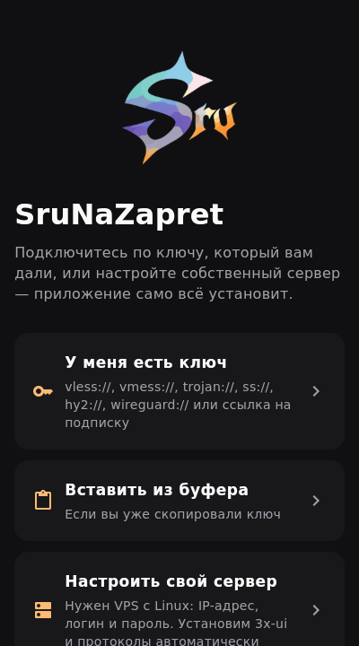
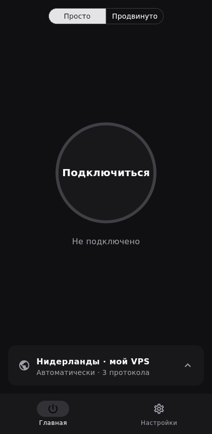
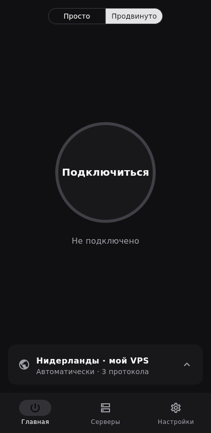

# SruNaZapret

VPN-клиент для Android и Windows 10/11.

Два режима для разных пользователей:

* **Lite** — интерфейс как у AmneziaVPN: одна кнопка «Подключиться», выбор сервера в нижней шторке, «Автоматически» вместо выбора протокола.
* **Pro** — как Happ: выбор конкретного протокола, пинг, конфиг Xray, маршрутизация, реклама, данные панели 3x-ui.

Главная функция — **«Настроить свой сервер»**. Пользователь вводит IP, логин и пароль VPS, а приложение по SSH:

1. проверяет права (root или sudo) и систему (systemd);
2. ставит **3x-ui** в неинтерактивном режиме со случайными логином, паролем, портом и путём;
3. закрывает панель от интернета (`listenIP 127.0.0.1`) — дальше приложение ходит в неё через SSH-туннель;
4. через API 3x-ui включает протоколы с общим `subId`, сам выбирая свободные порты и открывая их в ufw/firewalld;
5. забирает ссылки из подписки панели и добавляет сервер.

| Протокол | Lite | Pro |
|---|---|---|
| VLESS + Reality + Vision (TCP 443) | ✅ | ✅ |
| VLESS + Reality + XHTTP (TCP 8443) | ✅ | ✅ |
| Hysteria2 (UDP 443, самоподписанный сертификат с пиннингом) | ✅ | ✅ |
| Trojan + Reality | | ✅ |
| Shadowsocks 2022 | | ✅ |
| VMess + WebSocket | | ✅ |

**Автоподбор и проверка подключения.** В режиме «Автоматически» приложение одним запуском ядра проверяет сразу все протоколы и страны сервера или подписки: открываются ли через каждый Telegram и YouTube и с какой задержкой. Те, что подключились, но сайтов не открывают (так бывает, когда протокол режет DPI), пропускаются, и выбирается самый быстрый. На главном экране видны три лучших варианта и сколько не работает. После подключения показываются задержка до Telegram и YouTube и скорость загрузки через VPN (на ПК — сразу, на телефоне — по нажатию, чтобы не тратить мобильный трафик). На Android скорость скачивания и отправки видна в уведомлении.

Подписки и свой сервер обновляются сами — при запуске и после подключения, так что новые протоколы из панели 3x-ui появляются без ручного обновления.

**Раздельное туннелирование** (Pro), как в Amnezia:

* сайты — «только эти через VPN» или «все, кроме этих»; принимаются домены (с поддоменами), IP, подсети и категории `geosite:`/`geoip:`, есть быстрые кнопки YouTube, Telegram, Discord, Instagram, ChatGPT, Microsoft;
* приложения (Android) — те же два режима, список установленных приложений с поиском.

На Android локальные SOCKS/HTTP-входы ядра закрыты случайным паролем, который меняется при каждом подключении. Другие приложения не могут ими пользоваться или по ним определить VPN.

**Свой сервер из приложения** (Pro → Серверы → сервер → «Пользователи и трафик»). Можно добавлять пользователей с лимитом трафика и сроком, сразу показывать их ключи QR-кодом, видеть трафик и кто сейчас онлайн, отключать пользователя, сбрасывать трафик и удалять. Приложение подключается к панели по SSH и проверяет ключ сервера, сохранённый при установке.

**AmneziaWG** (Android и Windows) работает через встроенный в ядро движок amneziawg-go v3, Xray для него не нужен. Поддерживаются все поля AWG 1.x/2.0/3.1: Jc/Jmin/Jmax, S1–S4, H1–H4, I1–I5, HeaderProtectionKey, диапазоны таймеров, RandomTrailers/DisableCookies.
* Ключи принимаются в трёх видах: `.conf` целиком, `vpn://` из 3x-ui и `vpn://` родного формата AmneziaVPN.
* «Подключено» появляется только после настоящего рукопожатия с сервером.
* При установке своего сервера AmneziaWG включается и в «Автоматически» (последним, как запасной); его ключи и обфускацию генерирует сама панель 3x-ui.
* На Windows нужны права администратора: адаптер wintun, адреса, маршруты и DNS. Собственный UDP-сокет ядро привязывает к физическому интерфейсу, чтобы трафик не зацикливался.

**QR и диплинки.**
* Сканировать QR камерой (Android) или открыть картинку с QR (Windows).
* Поделиться сервером через QR: один ключ — как есть, несколько — ссылкой `sru://import/…`.
* Ссылки `sru://add/<ключ или подписка>`, а на Android — ещё и сами ключи `vless://` и др. открываются в приложении.

Клиент также принимает любые ключи и подписки: `vless://`, `vmess://`, `trojan://`, `ss://`, `hysteria2://`/`hy2://`, `wireguard://`, `socks://`, http(s)-подписки с заголовками `subscription-userinfo`/`profile-title`.

Подробный разбор Amnezia, Happ и 3x-ui — в [docs/ANALYSIS.md](docs/ANALYSIS.md).

| Онбординг | Lite | Pro |
|---|---|---|
|  |  |  |

## Структура

```
lib/core/links/        разбор ссылок и подписок
lib/core/xray/         сборка конфига Xray-core (TUN/прокси, маршрутизация «кроме РФ»)
lib/core/server/       SSH, установщик 3x-ui, API панели, пресеты протоколов
lib/core/vpn/          движок: MethodChannel (Android) и процесс sru-core + системный прокси (Windows)
core/                  ядро: Xray-core + обёртка (Android и десктоп)
lib/state/             состояние, хранение (секреты — в flutter_secure_storage)
lib/ui/                экраны
```

## Сборка и тесты

```bash
flutter pub get
flutter test                       # юнит-тесты
flutter run -d linux               # или android / windows / macos
```

Живой тест на настоящей панели 3x-ui и Xray: создаёт все 6 протоколов, собирает клиентские конфиги и пропускает через каждый HTTPS-запрос.

```bash
XUI_TEST_URL=http://127.0.0.1:<порт>/<путь> XUI_TEST_TOKEN=<apiToken> XRAY_BIN=/path/to/xray \
  flutter test test/integration/xui_live_test.dart
```

## Android

Нативная часть — `android/app/src/main/kotlin/ru/sru/sru/`:

* `vpn/SruVpnService.kt` — `VpnService`: поднимает TUN (IPv4 + IPv6, DNS внутри туннеля), исключает само приложение из VPN (`addDisallowedApplication`), запускает ядро и передаёт ему TUN-дескриптор через unix-сокет (SCM_RIGHTS). Показывает уведомление с кнопкой «Отключить» и реагирует на отзыв VPN системой и на падение ядра.
* `MainActivity.kt` — канал `ru.sru/vpn` для Flutter: запрос разрешения на VPN, `start`/`stop`/`coreVersion` и поток статусов.
* `vpn/CoreAssets.kt` — копирует geoip/geosite из APK для правил «кроме РФ» и блокировки рекламы.

Ядро — `core/`: Xray-core v26.10.10 с небольшой обёрткой на Go. Собирается без Android NDK (чистый Go, `CGO_ENABLED=0`) и попадает в APK как `libsrucore.so`. Gradle сам вызывает `core/build.sh` перед сборкой, нужен только Go 1.27+. Поддерживаются **arm64-v8a** (без NDK) и **armeabi-v7a** (Go для android/arm требует cgo, поэтому нужен Android NDK — в CI он есть).

```bash
flutter build apk --release --target-platform android-arm64
```

Тесты ядра: `cd core && go test -ldflags=-checklinkname=0 ./...`. Там же лежит e2e-тест (`e2e_test.go`), который на Linux повторяет путь пакетов Android: TUN → дескриптор через сокет → Xray → сервер → сайт.

## Windows 10/11

Приложение запускает то же ядро (`sru-core.exe`, режим `desktop`) как локальный прокси — SOCKS `127.0.0.1:10808`, HTTP `127.0.0.1:10809` (если их занял другой клиент — любые свободные порты) — и включает **системный прокси Windows**. Через него идут браузеры и большинство программ. Права администратора не нужны.

* Прежние настройки прокси сохраняются и возвращаются при отключении. Если приложение закрылось аварийно, они восстанавливаются при следующем запуске или при удалении программы.
* Ядро завершается вместе с приложением (следит за своим stdin), поэтому висящих процессов не остаётся.
* Системный прокси можно выключить в настройках и прописать прокси в нужной программе вручную.
* **Режим TUN** (Настройки → «Режим TUN — все программы»): через VPN идут и программы, которые игнорируют прокси (игры, некоторые клиенты). Xray создаёт адаптер wintun, сам прокладывает маршруты, свои соединения выводит мимо туннеля и через WFP закрывает утечку DNS. Нужны права администратора — приложение предложит перезапуститься с запросом UAC.
* **Трей:** закрытие окна сворачивает приложение в трей, VPN продолжает работать. Меню в трее: подключить/отключить, открыть, выйти.
* **Автозапуск** вместе с Windows, свёрнутым в трей, с подключением при старте или без.
* Работает только один экземпляр приложения: повторный запуск, например по ссылке `sru://` из браузера, передаёт её уже открытому окну.

Сборка (на Windows):

```bash
bash core/build_desktop.sh windows   # sru-core.exe + geo → build/core/windows
flutter build windows --release      # CMake кладёт их рядом с SruNaZapret.exe
```

## Готовые сборки

Последний релиз — на странице [Releases](../../releases). GitHub Actions (`.github/workflows/build.yml`) на каждый push собирает:

* `SruNaZapret-android.apk` (arm64 и armv7);
* `SruNaZapret-Setup-<версия>.exe` — установщик для Windows 10/11, ставится без прав администратора;
* `SruNaZapret-windows-x64-portable.zip` — версия без установки.

Файлы обычных сборок лежат 3 дня в Artifacts нужного запуска на вкладке Actions.

**Релиз:** поднять версию в `pubspec.yaml`, затем Actions → Build → Run workflow → отметить `release`. Сборка подпишет APK постоянным ключом из секретов репозитория (`ANDROID_KEYSTORE_BASE64`, `ANDROID_KEYSTORE_PASSWORD`, `ANDROID_KEY_ALIAS`, `ANDROID_KEY_PASSWORD`) и опубликует файлы в Releases под тегом `v<версия>`. Без ключа релиз не соберётся.

## Лицензия

[GPL-3.0](LICENSE). Лицензии сторонних компонентов (Xray-core, amneziawg-go, wintun и др.) — в [assets/licenses/THIRD_PARTY_NOTICES.txt](assets/licenses/THIRD_PARTY_NOTICES.txt) и в приложении: Настройки → Лицензии.
